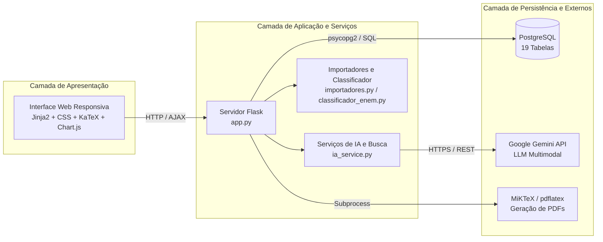

<div align="center">
  
  <h1>Banco de Questões - Cursinho PES</h1>
  <h2>Plataforma Web de Gestão de Questões, Simulados para o Projeto Educação Solidária (UFSC)</h2>
  <br>
  
  
  
  
  
  <br><br>
  
  
  
</div>

---

## Sobre o Projeto

Sistema web desenvolvido como trabalho final da disciplina de **Banco de Dados I (DEC 7129)** na **Universidade Federal de Santa Catarina (UFSC — Campus Araranguá)**.

A aplicação centraliza questões reais de vestibulares (**UFSC**, **ENEM**, **UDESC**) e questões **Autorais** em um banco de dados relacional PostgreSQL com **19 tabelas**, oferecendo busca, montagem de listas com exportação em PDF via LaTeX, simulados cronometrados com correção oficial de somatórias, painel administrativo CRUD completo e assistência pedagógica via IA Generativa (**Coruja do PES**).

### Objetivos

- Centralizar e estruturar o acervo de questões do Cursinho PES por disciplina, frente, conteúdo, banca e dificuldade.
- Otimizar a criação de listas de exercícios, simulados cronometrados e materiais em PDF pelos professores voluntários.
- Acompanhar o engajamento e o desempenho dos estudantes das Turmas A e B por meio de histórico de resoluções e relatórios analíticos.
- Integrar recursos de Inteligência Artificial generativa para apoio didático progressivo e extração automatizada de questões.

## Funcionalidades

- **Banco de Questões Inteligente:** filtros combinados por matéria, vestibular, ano, formato e dificuldade, busca por código (`Q005`).
- **Coruja do PES (IA Generativa):** geração sob demanda de dicas e resoluções comentadas passo a passo via API do Google Gemini.
- **Simulado Cronometrado:** execução de simulados a partir de listas, seleção manual ou sorteio de questões inéditas, com cronômetro pausável e cálculo oficial de pontuação parcial da COPERVE/UFSC para questões somatórias.
- **Listas de Exercícios e Exportação em PDF:** criação de tarefas públicas (docentes/gestão) e cadernos pessoais privados (alunos), com compilação automática para PDF em LaTeX (com ou sem gabarito) e fórmulas matemáticas renderizadas em KaTeX.
- **Importação e Curadoria de Provas:** cadastro manual (incluindo opção **Autoral**), importação direta via API do ENEM, leitura offline de PDFs de provas e gabaritos (UFSC/ENEM) e extração multimodal com Gemini para imagens e PDFs.
- **Central de Revisão e Sinalização:** qualquer usuário pode sinalizar problemas em questões (matéria, gabarito, gramática ou formatação), que entram em fila de revisão.
- **Administração Completa do Banco:** CRUD com busca e modais para todas as **19 tabelas**, cadastro unificado de usuários e manutenção da base (`ddl.sql`).
- **Relatórios Pedagógicos Animados:** painel de KPIs e gráficos interativos em Chart.js exibindo tempo médio por frente, engajamento das turmas, cobertura por banca/docente, equilíbrio do acervo e pontos de atenção pedagógica.

## Arquitetura do Projeto

Fluxo geral das camadas da aplicação em execução:



## Perfis de Acesso

O modelo utiliza especialização total e exclusiva a partir da tabela `usuario` (`gestao`, `professor` e `aluno`):

**Gestão**

- Acesso administrativo completo ao sistema.
- Cadastra usuários (Alunos, Professores e Gestão), administra todas as 19 tabelas do banco, realiza manutenção da base (`ddl.sql`), importa provas completas e acessa relatórios pedagógicos.

**Professor**

- Vinculado exclusivamente a uma disciplina e frente (`uq_professor_disciplina`), ao seu curso de graduação na UFSC e matrícula.
- Cadastra questões (manuais/autorais ou via IA), cria novos conteúdos, monta listas públicas para os alunos, revisa questões sinalizadas e visualiza relatórios.

**Aluno**

- Vinculado à Turma A ou B e à escola pública de origem.
- Resolve questões com feedback imediato, realiza simulados cronometrados, consulta a Coruja do PES, cria cadernos pessoais privados e acessa seu histórico clicável com opção de refazer questões erradas.

## Tecnologias

### Back-end e Banco de Dados

- **Linguagem:** Python 3.12
- **Framework Web:** Flask + Gunicorn
- **Banco de Dados:** PostgreSQL (`psycopg2-binary`)
- **IA Generativa:** `google-genai` (Gemini)
- **Processamento de Dados e PDF:** `pandas`, `matplotlib`, `pymupdf`, `pdflatex` (MiKTeX)

### Front-end e Visualização

- HTML5 / Jinja2 + CSS3 responsivo (barra lateral retrátil para ícones)
- Vanilla JavaScript (AJAX / `fetch`)
- KaTeX (renderização de expressões matemáticas em LaTeX)
- Chart.js (gráficos analíticos animados)

## Instalação e Execução

### 1. Clonar o repositório e instalar dependências

```bash
git clone <URL_DO_REPOSITORIO>
cd codigo
pip install -r requirements.txt
```

### 2. Configurar o PostgreSQL e Variáveis de Ambiente

Crie o banco `pes_questoes` no PostgreSQL e copie o arquivo `.env.example` (ou defina as variáveis no sistema):

**Parâmetros de Configuração:**

- `DB_HOST`: Endereço do servidor PostgreSQL (padrão: `localhost`).
- `DB_PORT`: Porta do PostgreSQL (padrão: `5432`).
- `DB_NAME`: Nome do banco de dados (padrão: `pes_questoes`).
- `DB_USER`: Usuário do PostgreSQL (padrão: `postgres`).
- `DB_PASSWORD`: Senha do PostgreSQL (padrão: `postgres`).
- `GEMINI_API_KEY`: Chave da API do Google Gemini para a Coruja do PES e extração de provas.

### 3. Criar as Tabelas e Carregar os Dados Iniciais

A partir de um banco vazio, execute o gerenciador de base (ou utilize o botão **Criar e Carregar Base** na aba Administração):

```bash
python -m database.gerenciar_db
```

### 4. Iniciar a Aplicação

```bash
python app.py
```

Acesse no navegador: `http://localhost:5000`

> [!NOTE]
> **Contas de teste da carga inicial (`ddl.sql`):**
>
> - **Gestão:** `clara.grossl@pes.ufsc.br` / `senha123`
> - **Professor:** `gabriel.rocha@pes.ufsc.br` / `senha123`
> - **Aluno:** `joao.silva@gmail.com` / `senha123`

> [!NOTE]
> **Geração de Gráficos Estáticos:** Para executar as 3 consultas analíticas do relatório via terminal e exportar as imagens PNG em `data/graficos/`, utilize `python -m database.consultas_graficos`.

## Estrutura do Projeto

```text
codigo/
├── app.py                          # Servidor Flask principal (rotas, auth, APIs e PDF)
├── requirements.txt                # Dependências Python
├── .env.example                    # Modelo de variáveis de ambiente
├── database/                       # Camada de banco de dados
│   ├── conexao.py                  # Conexão PostgreSQL
│   ├── ddl.sql                     # Script DDL completo (19 tabelas + carga inicial)
│   ├── gerenciar_db.py             # Criação, remoção e carga inicial da base
│   ├── crud.py                     # Mapa das 19 tabelas e CRUD
│   └── consultas_graficos.py       # 3 consultas SQL analíticas + exportação PNG
├── services/                       # Camada de regras de negócio e IA
│   ├── ia_service.py               # Coruja do PES (Gemini)
│   ├── importadores.py             # Importadores ENEM (API) e provas em PDF
│   └── classificador_enem.py       # Classificador determinístico (INEP + léxico)
├── data/                           # Consultas documentadas e saídas geradas
│   ├── consultas.sql               # As 3 consultas SQL do relatório
│   └── graficos/                   # Gráficos PNG gerados
├── templates/                      # Views Jinja2 responsivas
├── templates_tex/                  # Modelo LaTeX para listas em PDF
└── static/                         # CSS, logo do PES e uploads de figuras
```

## Licença

Distribuído sob a licença MIT.
